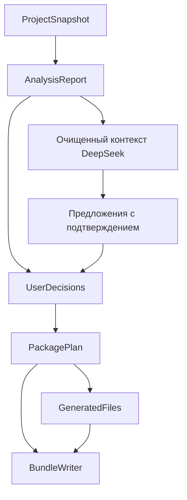

# Архитектура ядра

Ядро анализирует небольшой Python-проект, объясняет найденные зависимости и неопределенности, принимает решения автора и генерирует согласованный пакет для повторного запуска. Статус успешного воспроизведения требует отдельной проверки.

## Компоненты

| Компонент | Ответственность |
| --- | --- |
| `SnapshotBuilder` | Ограниченный неизменяемый снимок файлов, относительные пути, хеши |
| `ArchiveReader` | Чтение ZIP без распаковки на диск, проверка путей и лимитов |
| `AnalysisJobRunner` | Новый процесс анализа, лимиты, таймаут и проверенный JSON-протокол |
| `LayoutDetector` | Выбор корня проекта и корней импортов, явная диагностика неоднозначности |
| `ProjectAnalyzer` | AST, исходные наблюдения, манифесты, классификация импортов |
| `ManifestReader` | requirements и стандартный pyproject, декларации с ID и optional groups без build hooks |
| `DependencyResolver` | Локальные модули, stdlib текущего профиля, внешние пакеты, неопределенности |
| `ProjectInspector` | README, LICENSE, CSV/JSON, простые ссылки на входные файлы |
| `SecretScanner` / `TextRedactor` | Диагностика потенциальных секретов и очистка публичных данных |
| `PackagePlanner` | Решения автора, версии, запуск, файлы, состояние пакета |
| `DocumentRenderer` | README, requirements, JSON-отчет из одного плана |
| `ProjectLauncher` | Переносимый `run_project.py` для выбранных корней импортов и console callable |
| `BundleWriter` | ZIP строго по списку и хешам плана |
| `AdvisoryService` | Необязательные проверяемые предложения DeepSeek |
| `DockerfileGenerator` | Необязательный шаблон для обычного pip-проекта |
| `AuthorEnvironmentInspector` | Явный сбор и применение сведений среды автора |
| `CondaEnvironmentReader` | Раздельное чтение Conda и вложенных pip-зависимостей |
| `DecisionsCodec` | Чтение и запись решений для CLI с проверкой структуры |

`ReproducibilityService` объединяет анализ, инспекцию, диагностику секретов, планирование и генерацию. Ядро не содержит HTTP, базы данных или фоновой очереди. Эти компоненты реализованы отдельно в пакете `nishtyak_service` и используют публичный контракт ядра. Основная зависимость — `packaging`; PyYAML нужен только для Conda. Контейнерный запуск и границы изоляции описаны в [SERVER_RUNTIME.md](SERVER_RUNTIME.md).



## Публичный контракт

```python
service.analyze(snapshot, options=None, author_environment=None) -> AnalysisReport
service.prepare(report, decisions) -> PackagePlan
service.render(plan, include_dockerfile=False) -> GeneratedFiles
BundleWriter().write(snapshot, plan, generated, destination) -> PackageArtifact
```

Сервер хранит исходный снимок и отчет. От клиента принимаются решения, а не готовые доверенные отчеты и планы. После изменения файлов, корней исходников или сведений среды нужен новый анализ. Его идентификатор защищает от применения устаревших решений.

`nishtyak_client.LogicClient` предоставляет серверному backend загрузку, ожидание задания, повторный анализ, чтение/сохранение решений, план и ZIP. Клиент передает service token и owner, ограничивает ответы и не следует перенаправлениям с учетными данными. Токен остается на backend. OpenAPI и проверки HTTP-клиента покрывают границу интеграции; подключение пользовательского интерфейса выполняется вторым разработчиком.

## Данные и состояния

`ProjectSnapshot` хранит относительные пути и байты. Fingerprint зависит от имен и содержимого файлов. `ImportObservation` сохраняет модуль, файл, строку, относительный уровень, вид и контекст импорта. `DependencyCandidate` содержит категорию, предлагаемый пакет, ограничение, происхождение и ссылки на наблюдения. `Finding` имеет стабильный ID, код, серьезность, расположение и объяснение без исходного фрагмента.

`ProjectLayout` хранит корень проекта, доступные кандидаты корня, признак неоднозначности и эффективные корни импортов относительно ZIP. `AnalysisOptions.source_roots` задаются относительно выбранного `project_root`; исходные пути файлов и fingerprint сохраняются. Автовыбор допускается для однозначной структуры, а неоднозначный проект требует явного выбора. Манифесты и инспекция читаются в выбранном корне; соседние подпроекты не становятся его исходниками.

`DependencyDeclaration` хранит исходное требование, стабильный ID, путь, доступную строку и optional group. `UserDecisions` задает пакеты, версии, исключения, выбранные extras, действия `keep/replace/exclude` по ID деклараций, `RunSpec`, Python и описание эксперимента. Решения сохраняются в `PackagePlan` отдельно от исходного отчета. Генератор использует этот план, не анализируя исходники повторно. Ошибки решений содержат код и поле, не повторяя произвольный пользовательский ввод в сообщении.

| Поле | Значения | Значение для приложения |
| --- | --- | --- |
| `AnalysisReport.status` | `complete`, `partial` | Полнота поддерживаемого анализа; partial возвращается вместе с результатами |
| `PackagePlan.state` | `draft`, `ready_to_verify`, `blocked` | Черновик можно скачать; blocked нужно исправить до генерации |
| `AdvisoryResult.status` | `ok`, `unavailable`, `invalid_response`, `invalid_request` | Состояние дополнительной AI-функции |

`complete` не доказывает обнаружение любых динамических зависимостей. `ready_to_verify` не означает успешный запуск. Неуказанная точная версия может оставаться предупреждением; неразрешенные зависимости, неподтвержденные данные и противоречия оставляют черновик.

## Импорты и зависимости

- AST разбирает `import`, `from`, псевдонимы и известные формы динамического импорта. Пользовательские модули не импортируются; subprocess, `setup.py` и build hooks не используются.
- Локальные модули определяются относительно `source_roots`; относительные импорты — относительно текущего пакета. Наличие одноименного файла в другой папке не делает его доступным.
- Каталог stdlib соответствует версии работающего анализатора. Другой запрошенный профиль дает частичный анализ и предупреждение.
- Известные внешние импорты сопоставляются с пакетами небольшим проверенным словарем. Неизвестные остаются вопросами пользователю.
- Коллизии локальных имен видны. Условные и type-checking импорты сохраняют контекст; произвольные условия не исполняются.
- Сохраняются версии, extras и markers. Различные markers не схлопываются по имени пакета. Синтаксическая валидность требования не доказывает совместимость установки.
- Объявленная зависимость сохраняется, даже если статический импорт не найден. Противоречивые ограничения не заменяются молча.
- Отдельная декларация изменяется только явным действием автора. При замене сохраняются неуказанные markers и extras. Исключение импорта и исключение декларации имеют разную семантику: если после удаления требования остается импорт, нужен явный выбор пакета либо исключение этого импорта.
- Выбранные optional groups включаются в эффективный список требований. Имена групп нормализуются, коллизии отклоняются. Невыбранная группа не возвращается в requirements через автоматическое предположение о пакете.
- Конфликты плана пересчитываются по эффективным требованиям; исходные факты остаются в отчете. Явно разрешенный конфликт не удерживает план в `draft`, а нерешенное противоречие сохраняет этот статус.

Манифесты: поддержаны обычные требования, ограниченные локальные `-r`, стандартные runtime/optional поля pyproject и callable из `project.scripts`. Includes не выходят за выбранный корень. Динамическая metadata, специальные опции pip, direct URL и tool-specific декларации дают диагностику. Build-зависимости отделены от runtime.

Для данных используются сведения автора и ограниченные эвристики строковых аргументов `open/read_csv/read_json/read_excel/loadtxt/genfromtxt`. Найденные пути не являются доказательством полного набора входов.

## Генерация и экспорт

```text
bundle/
  README.md
  requirements.txt
  analysis-report.json
  run_project.py           # при необходимости явных source roots или callable
  Dockerfile               # только при явном выборе
  project/
    ...исходные относительные пути...
```

Команда строится из `RunSpec(kind, target, args, working_directory)`. Поддержаны `script`, `module` и `callable` с целью `module:attribute`. Нужный исходный модуль и рабочая папка должны остаться в пакете; наличие самого callable подтверждается локальным запуском. Имена и аргументы экранируются для POSIX shell; Docker использует JSON exec form. README указывает рабочую папку, установку, входы, ожидаемый результат и предупреждения.

Для `src` layout и callable генерируется `run_project.py`: он применяет согласованные корни импортов и рабочую папку, передает аргументы и запускает выбранную цель. Проект не требуется устанавливать через его build hooks. Helper исполняется автором или коллегой для доверенного проекта; сервер его не запускает.

Оригинальный README сохраняется внутри `project/`. Экспорт включает только выбранные файлы с совпадающими хешами. Секретные значения не копируются в публичный JSON или AI-контекст. Обнаруженный секрет блокирует экспорт содержащего файла до очистки либо исключения. Известные файлы ключей, окружения и кэши исключаются базовой политикой. Это эвристическая проверка, не гарантия отсутствия любых секретов.

ZIP детерминирован для одинакового плана и содержимого. Побитовая идентичность упаковки не означает идентичность научных вычислений.

## Дополнительные функции

`AuthorEnvironmentInspector.collect()` вызывается явно на машине автора и читает Python, платформу и метаданные установленных дистрибутивов. Он не собирает переменные окружения. `enrich()` использует только относящиеся к проекту пакеты, сохраняет объявленные ограничения и конфликты, меняет `analysis_id`.

HTTP принимает этот снимок при загрузке и повторном анализе. Сервис валидирует и хранит его отдельно от системной среды. В Docker worker снимок передается через stdin с ограниченным заголовком длины: до 256 КиБ metadata, затем ZIP со своим прежним лимитом. Сведения не попадают в переменные среды или длинный аргумент командной строки. Наблюдаемая версия дополняет требование без версии; объявленное ограничение не заменяется молча.

## Сохранение и совместимость

`SQLiteJobRepository` хранит ZIP, текущий отчет, параметры анализа, снимок среды и отдельный документ решений. `PUT` решений проверяет `analysis_id` и ожидаемую revision в одной транзакции; конкурирующее сохранение получает конфликт. После повторного открытия возвращаются сохраненные решения и revision. План остается производным.

Повторный анализ использует сохраненный ZIP, создает новый job ID и очищает решения с увеличением revision. Он не продлевает TTL и не освобождает резерв хранения. Активный worker или операция с lease запрещают замену задания. Ownership, отзыв доступа и отложенное физическое удаление действуют также на новые данные.

Новые отчеты используют `schema_version: 2`. `AnalysisReportCodec` читает прежнюю схему 1 и параметры без `project_root`; новые поля получают значения по умолчанию. Миграция SQLite добавляет поле среды и таблицу решений, сохраняя существующие проекты. Совместимость проверяется регрессиями, а приемка обновления VM выполняется отдельно.

`CondaEnvironmentReader.read()` сохраняет каналы, Conda-спецификации и вложенную секцию pip раздельно. Алиасы и чрезмерная вложенность YAML отклоняются. Чтение Conda не превращает проект в согласованный pip-профиль; автоматического преобразования нет.

`DockerfileGenerator` требует `ready_to_verify`, выбранный Python и запуск. Он поддерживает простой pip-профиль; Conda и direct URL требуют отдельного решения. Шаблон не собирается автоматически.

DeepSeek объясняет предупреждения, предлагает описание README или гипотезы пакетов. Передается ограниченный очищенный контекст. Ответ проверяется по схеме, анализу, функции и существующим evidence IDs. Любое предложение требует подтверждения. Основные документы и зависимости не меняются ответом модели автоматически.

## Ограничения первой версии

- Исполнения пользовательских загрузок и полного решателя транзитивных зависимостей нет. Внутренний HTTP-сервис реализован отдельным пакетом.
- Нет гарантии работы на всех ОС, Python и аппаратуре.
- Снимок среды дополняет сведения и не заменяет явно объявленные ограничения.
- При снятии конфликта исходные предупреждения остаются в исходном отчете как факты анализа; состояние плана определяется актуальными решениями.
- SDK и HTTP-контракт реализованы; пользовательский frontend/backend подключается отдельным разработчиком.
- Боевой DeepSeek пока не проверен. Экспортированные Dockerfile собраны и запущены на двух зафиксированных публичных проектах; произвольные пользовательские образы сервис не собирает. Проверка контейнера самого сервиса учитывается отдельно. Автотесты AI используют подставной транспорт.

Источники технических решений сохранены в [research.json](research.json). Они поясняют семантику Python и форматов; поддерживаемая область определяется кодом и тестами этой ветки.
