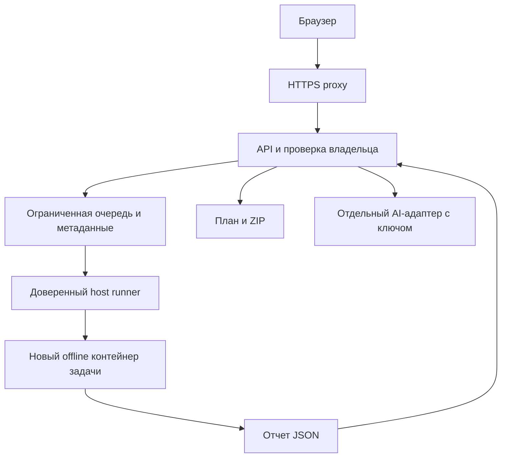

# Серверный запуск и изоляция

Для первого Linux-сервера предлагается HTTP API с ограниченной очередью и отдельным статическим анализатором. HTTP-адаптер и хранение задач реализует второй разработчик. В этой ветке доступны безопасный читатель ZIP, ограниченный subprocess runner, контейнер анализатора и скрипт запуска одной контейнерной задачи.

Загруженные Python-файлы, setup.py, build hooks и Dockerfile не выполняются. Установка зависимостей загруженного проекта на сервере не производится. Для защиты хакатонные примеры проверяются отдельно как собственные доверенные проекты команды.

## Контур сервиса



Доступ к Docker daemon имеет только доверенный runner на хосте. Docker socket не монтируется в API, анализатор или загруженный проект. Анализатор не получает ключи API, сеть, каталоги других задач и host bind mounts. ZIP поступает через stdin, результат возвращается через stdout.

Состояния очереди: queued → running → succeeded/failed/timed_out/resource_limited → expired. Статус partial относится к результату анализа и совместим с успешной задачей. Нужны ограничение общей очереди, контроль параллельности на весь сервис и восстановление незавершенных задач после рестарта.

## Первая VM на Vast.ai

Целевой сервер: 8 CPU и 120 GB RAM. Предлагаемые начальные настройки сервиса: один доверенный диспетчер, 2 работающих контейнера, очередь до 32 ожидающих задач, не более 2 активных задач одного владельца. Каждый контейнер сохраняет лимит 1 CPU / 512 MiB; доступная память сервера не отменяет лимиты обработки недоверенных данных. Это стартовые параметры, не измеренная пропускная способность.

Для первой итерации на одной VM достаточно SQLite для метаданных задач и отдельного закрытого каталога файлов. Один диспетчер атомарно забирает queued-задачи, сохраняет terminal status и восстанавливает running после рестарта. API не держит очередь только в памяти. Если уже выбран PostgreSQL, таблица задач остается в нем; отдельный брокер для первой версии необязателен.

Предлагаемый бюджет файлов — 2 GiB на весь сервис, TTL 1 час, cleanup также после ошибок и рестарта. Лимит должен резервироваться до приема upload/генерации ZIP и проверяться по фактическим байтам; при заполнении новые задачи отклоняются. Базу и каталоги задач не публикуют через web server. DeepSeek получает отдельный ключ в окружении AI-адаптера, а не в общем окружении обработчиков.

У Vast.ai полноценная VM поддерживает systemd и Docker внутри. Обычный Docker instance отличается от VM; наличие SSH само по себе не доказывает тип среды. На выбранном сервере сначала проверить тип инстанса, Docker daemon, cgroups и доступные дисковые квоты. [VM на Vast.ai](https://docs.vast.ai/linux-virtual-machines), [обычная контейнерная среда](https://docs.vast.ai/guides/instances/docker-environment).

Публичным приложением служит HTTPS proxy с frontend/API; API и хранилище доступны только из внутреннего контура. Порт proxy нужно заранее добавить в шаблон Vast и проверить внешний port mapping. Конкретный домен, сертификат, размер диска и параметры SSH определяются при развертывании.

## Реализованные ограничения

| Ограничение | Значение по умолчанию | Где применяется |
| --- | --- | --- |
| ZIP | 10 MiB | ArchiveReader и stdin worker |
| Фактически распакованные данные | 50 000 000 байт | ArchiveReader и SnapshotBuilder |
| Записи ZIP | 1000 | ArchiveReader |
| Файл в ZIP | 10 MiB | ArchiveReader |
| Коэффициент сжатия | 200 | ArchiveReader |
| Python-исходник | 1 000 000 байт | AnalysisOptions |
| Итоговый JSON задачи | 8 MiB | Кодирование и чтение результата |
| Wall timeout subprocess | 30 секунд | AnalysisJobRunner |
| Wall timeout контейнерной команды | 35 секунд + принудительная очистка | deploy/analyze.sh |
| CPU процесса | 15 секунд | Worker RLIMIT_CPU |
| Память процесса на Linux | 512 MiB | Worker RLIMIT_AS |
| Память контейнера | 512 MiB, без дополнительного swap | Docker |
| CPU/PID контейнера | 1 CPU / 32 PID | Docker |
| tmpfs | 32 MiB | Docker |

ZIP читается ограниченными порциями без extractall. Отвергаются выход за корень, нормализованные дубли, конфликт файла и каталога, симлинки, специальные файлы, шифрование и неподдерживаемое сжатие. Предел фактически прочитанных байтов проверяется отдельно от заголовков архива. Вложенные архивы не распаковываются.

## Локальный runner для подключения API

```python
from nishtyak_core import AnalysisJobRunner

# Один общий экземпляр на процесс API; путь назначает сервер.
runner = AnalysisJobRunner()
result = runner.run(server_owned_archive_path)
if result.status == "succeeded":
    public_report = result.report.to_dict()
```

Каждая задача получает новый процесс Python с -I, приватным временным каталогом, очищенным окружением и ограничениями. При таймауте уничтожается группа процессов; слот освобождается. Ошибки возвращаются кодами без traceback и исходников. Результат декодируется только в известные модели через ограниченный JSON; pickle не используется.

Этот runner отделяет процесс и ограничивает ресурсы, но сам по себе не изолирует файловую систему или сеть. Для недоверенных публичных загрузок используйте контейнерную границу. Его semaphore ограничивает один экземпляр runner; несколько API-процессов требуют общего диспетчера.

После анализа API может снова прочитать тот же серверный ZIP через ArchiveReader для формирования плана/экспорта; повторного AST-разбора для этого не требуется. Должно проверяться совпадение fingerprint. Не принимайте снимок, отчет или план из клиентского JSON как доверенный объект.

## Контейнерная задача на Linux

```sh
docker compose -f deploy/compose.yaml build analyzer
bash deploy/analyze.sh /srv/nishtyak/jobs/example/input.zip /srv/nishtyak/jobs/example/report.json
```

Скрипт использует уже собранный локальный image, новый container name, таймаут и trap с принудительным удалением. Очистка Docker также ограничена отдельным таймаутом; если daemon не отвечает и удаление не подтвердилось, диспетчер не должен считать ресурс освобожденным и должен повторить уборку после восстановления daemon. Исходники хоста не монтируются. Временный файл отчета имеет права по umask 077; контейнерные логи отключены, чтобы не дублировать отчет в журналах Docker.

Прямой ручной запуск через Compose для проверки stdin/stdout:

```sh
docker compose -f deploy/compose.yaml run --rm -T analyzer < input.zip > report.json
```

Прямой Compose-запуск не дает внешнего wall timeout; при обработке запросов нужен скрипт либо эквивалентный supervisor с гарантированной очисткой. HTTP-процесс не должен напрямую выполнять этот shell-скрипт с произвольными параметрами клиента. Доверенный диспетчер назначает пути/имена, контролирует очередь и хранит результат.

Worker возвращает приватный протокольный конверт `{status, report, code}`. В нем сохраняется внутренний отчет для дальнейшего планирования. API декодирует его через AnalysisReportCodec и использует report.to_dict() для публичного ответа; не пересылайте сырой внутренний JSON и не записывайте его в общие журналы.

## Профиль контейнера

Настроены непривилегированный UID, read-only root filesystem, tmpfs, отсутствие сети, cap_drop ALL, no-new-privileges, лимиты CPU/RAM/PID. Стандартный seccomp остается включенным. Это изоляция статической обработки с ограниченной поверхностью, а не обещание безопасного исполнения любых программ.

Rootless Docker уменьшает права daemon. Его cgroup-лимиты требуют cgroup v2 и systemd; нужно проверить доступные/delegated контроллеры на конкретном VPS, иначе flags могут игнорироваться. [Rootless](https://docs.docker.com/engine/security/rootless/), [ограничения rootless](https://docs.docker.com/engine/security/rootless/tips/), [seccomp](https://docs.docker.com/engine/security/seccomp/).

Если позднее изменится задача и появится исполнение произвольного пользовательского кода, ему потребуется отдельный executor и усиленная граница, например gVisor или microVM, с самостоятельной политикой сети, установки пакетов и квот. Обычные контейнеры используют ядро хоста. [Модель безопасности gVisor](https://gvisor.dev/docs/architecture_guide/security/).

## Что остается до публичного сервиса

1. HTTP DTO и асинхронные задачи: 202 на постановку, отдельный статус, отчет и скачивание.
2. Владелец задачи: session/auth или проверяемый токен доступа. Один непредсказуемый project_id не заменяет проверку доступа.
3. Ограниченная общая очередь, параллельность 1–2 на первый сервер, rate limiting, ограничения диска и размера upload на proxy/API.
4. TTL очистка исходников, отчетов и ZIP, например 1 час для учебного сервиса; удаление по запросу владельца.
5. Health/readiness, восстановление после рестарта, метрики длительности/размеров/кодов ошибок без содержимого файлов.
6. DeepSeek только в отдельном разрешенном egress-контуре с ключом и лимитами контекста/расхода.
7. Linux smoke: сборка image, реальный запуск, принудительный timeout/OOM, проверка сетевого запрета, UID, mounts и cgroups.

На текущей машине Docker CLI доступен, daemon не запущен. Поэтому Compose проверен статически, shell-синтаксис и subprocess проверены; сборка image и Linux container isolation пока не подтверждены.
