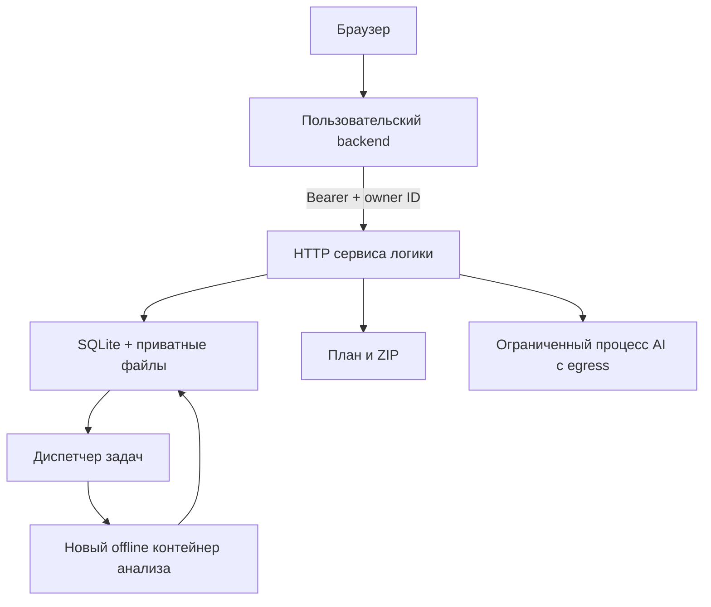

# Запуск сервиса логики

Сервис реализован в `nishtyak_service`: внутренний HTTP API, постоянная очередь, хранение проектов, проверка владельца, TTL, планирование, экспорт и необязательный DeepSeek. Второй разработчик подключает к нему свой пользовательский backend и frontend. Логин, браузерные сессии и публичный HTTPS остаются в его приложении.

## Компоненты



Это один разворачиваемый сервис с несколькими процессами. У HTTP и диспетчера общие SQLite и volume; отдельного Redis или брокера для одной VM не требуется. SQLite WAL хранится на локальном диске, не на сетевой файловой системе. Только один диспетчер владеет файловой блокировкой очереди.

HTTP-процесс не получает Docker socket. Им пользуется только доверенный диспетчер; его доступ к daemon дает широкие права на хосте, поэтому он не принимает HTTP-запросы и не исполняет загруженные команды. Контейнер анализа не получает socket, ключи, сеть или host mounts. ZIP передается через stdin, результат — через ограниченный stdout. Python-файлы, setup.py, build hooks и Dockerfile пользователя не выполняются; зависимости его проекта не устанавливаются.

Контейнер изолирует распаковку и AST-анализ. Планирование и сборка ZIP выполняются в HTTP-процессе над проверенным отчетом и тем же ZIP; они ограничены размерами данных, общей емкостью операций и лимитами HTTP-контейнера. Включенный AI работает в отдельном процессе с жестким wall timeout 20 секунд; он получает только настройки DeepSeek, без межсервисного ключа. Предложения не исполняются.

## Локальная разработка

Python 3.11+, из корня репозитория:

```sh
python -m venv .venv
. .venv/bin/activate
python -m pip install -e '.[service,dev]'
export NISHTYAK_SERVICE_TOKEN=$(python -c 'import secrets; print(secrets.token_hex(32))')
nishtyak-service dev --host 127.0.0.1 --port 8010
```

`dev` поднимает HTTP и диспетчер вместе. Анализ идет в отдельном процессе с лимитами, но без изоляции файловой системы и сети: это режим собственных тестовых проектов команды. HTTP доступен на 8010; `/healthz` открыт, `/readyz` и `/openapi.json` требуют Bearer. Все `/v1/*` дополнительно требуют `X-Owner-ID`. [Контракт](API_CONTRACT.md).

`NISHTYAK_DATA_DIR` задает каталог состояния, по умолчанию `var/nishtyak`. Каталог содержит SQLite, исходные ZIP и приватные отчеты. Это состояние сервиса, а не часть Git. После перезапуска queued-задачи сохраняются. Отдельные команды: `nishtyak-service serve` и `nishtyak-service dispatch`; режим обработки задается `NISHTYAK_RUNNER=docker|subprocess`, по умолчанию docker.

## Linux VM на Vast.ai

Цель: полноценная VM, 8 CPU и 120 GB RAM. У Vast обычный Docker instance отличается от VM: для запуска своих контейнеров нужна VM с Docker. Проверить тип среды, наличие daemon, диск и cgroups до развертывания. [VM Vast](https://docs.vast.ai/linux-virtual-machines), [контейнерные инстансы](https://docs.vast.ai/guides/instances/docker-environment).

Создать приватный `.env` один раз; существующий файл команда не перезаписывает. Для rootless daemon предварительно задать `NISHTYAK_DOCKER_SOCKET` его реальным путем.

```sh
umask 077
python3 - <<'ENV'
import os
import secrets
from pathlib import Path
socket = os.environ.get("NISHTYAK_DOCKER_SOCKET", "/var/run/docker.sock")
with Path(".env").open("x") as stream:
    stream.write(f"NISHTYAK_SERVICE_TOKEN={secrets.token_hex(32)}\n")
    stream.write(f"NISHTYAK_DOCKER_SOCKET={socket}\n")
    stream.write(f"NISHTYAK_DOCKER_GID={os.stat(socket).st_gid}\n")
ENV
docker compose --env-file .env -f deploy/service-compose.yaml --profile build build
docker compose --env-file .env -f deploy/service-compose.yaml up -d logic dispatcher
```

Compose создает приватный volume, запускает HTTP и диспетчер с restart policy. Образ анализатора собирается заранее; задачи не тянут образы из сети. Повторный `up` сохраняет очередь и данные. `down -v` удаляет состояние сервиса.

Внутренний порт опубликован только на `127.0.0.1:8010`. Backend на хосте использует этот адрес. Backend в другом контейнере подключается к сети `nishtyak-logic_default` и адресу `http://logic:8010`. Для другого сервера нужен защищенный внутренний канал. Секрет из `.env` находится в конфигурации backend; браузер его не получает. DeepSeek включается добавлением `DEEPSEEK_API_KEY` и `DEEPSEEK_MODEL` в `.env` и пересозданием logic; диспетчеру они не передаются.

Проверка настоящего Docker runtime после сборки:

```sh
docker compose --env-file .env -f deploy/service-compose.yaml run --rm -T --no-deps \
  --entrypoint python dispatcher - < deploy/verify_runtime.py
```

Проверка создает только собственные временные контейнеры, проверяет профиль и завершение задачи, выводит JSON и удаляет их. Успешный статический `compose config` не заменяет эту проверку.

## Лимиты и жизненный цикл

| Ресурс | Начальное значение |
| --- | --- |
| Обработка | 2 одновременно на весь сервис, включая plan/bundle/advice |
| Очередь / владелец | До 32 queued; до 2 queued/running одного владельца |
| ZIP / expanded / entries | 10 MiB / 50 000 000 байт / 1000 |
| Отдельный файл / Python source | 10 MiB / 1 000 000 байт |
| Сжатие | Коэффициент не выше 200 |
| Отчет / итоговый ZIP | 8 MiB / 80 MiB |
| Анализ: wall / CPU / RAM | 30 секунд / 15 секунд / 512 MiB |
| Контейнер анализа | 1 CPU, 32 PID, без сети и swap, tmpfs 32 MiB |
| HTTP | 8 запросов, body deadline 30 секунд, JSON 256 KiB |
| HTTP-контейнер | 2 CPU, RAM 1 GiB, tmpfs 128 MiB |
| AI | Wall 20 секунд, CPU 10 секунд, RAM 512 MiB на Linux |
| Данные | TTL 1 час, общий резерв 2 GiB, владелец 256 MiB |

Лимиты задаются сервером, клиент не повышает их через options. Дисковый резерв проекта: ZIP + два отчета + предельный ZIP результата + 1 MiB; он учитывает временные файлы. Поэтому квота хранения может остановить прием раньше предела очереди. Это бюджет файлов приложения; на VM также нужен запас под ОС, образы, SQLite WAL и ограниченные журналы. Квота не заменяет свободное место и файловые квоты хоста.

Транзакции SQLite обеспечивают постановку, квоты, claim и ограничения общей параллельности. Lease защищает файлы активного экспорта от очистки. DELETE и TTL сразу отзывают доступ; диспетчер отменяет работающий анализ. Слот и резерв освобождаются после подтвержденной очистки. Неудачная уборка повторяется, поздний результат не восстанавливает проект. Прерванный running после рестарта завершается WORKER_RESTARTED после уборки; queued продолжает работу.

Readiness зависит от heartbeat диспетчера. При недоступном daemon, проблеме cleanup или остановке диспетчера он выключается. При сбое API срок lease ограничивает задержку освобождения его операций. Сервис не обещает отозвать байты уже начавшегося HTTP-ответа.

## Граница защиты и приемка

Непривилегированный UID 65532, read-only rootfs, cap_drop ALL, no-new-privileges, стандартный seccomp, отсутствие сети и host mounts настроены для анализа. Rootless Docker уменьшает права daemon, но для его resource limits нужны корректные cgroup v2/systemd и делегированные контроллеры. [Rootless](https://docs.docker.com/engine/security/rootless/), [лимиты](https://docs.docker.com/engine/security/rootless/tips/), [seccomp](https://docs.docker.com/engine/security/seccomp/).

Если позднее понадобится исполнять произвольные пользовательские программы, это отдельный executor и отдельная приемка границы, например gVisor или microVM. Обычные контейнеры разделяют ядро хоста. [gVisor](https://gvisor.dev/docs/architecture_guide/security/).

На Linux VM образы собраны и сервис запущен. Проверены фактические cgroups, UID, сеть, rootfs, tmpfs, timeout и cleanup без оставшихся контейнеров. HTTP-проверка прошла путь ZIP → отчет → план → ZIP, foreign-owner404, stale409, невалидный архив и удаление. Отдельно queued-задача пережила перезапуск HTTP и диспетчера. Машинный результат: [service-verification.json](../examples/service-verification.json). Следующая приемка — второй backend, HTTPS/frontend и реальный проект команды. В первоначальной приемке AI не вызывался; живая проверка v0.3.0 выполнена отдельно.

Повторяемая HTTP-проверка без AI: `NISHTYAK_SERVICE_TOKEN=... python3 deploy/verify_service.py --url http://127.0.0.1:8010`. Она создает собственные тестовые проекты и удаляет их; ключ не выводится.

## Обновление до 0.2.0

Образы HTTP/dispatcher/analyzer используют отдельный тег `0.2.0`, поэтому старый dispatcher во время сборки продолжает запускать свой образ. Сначала собрать все три новых образа, затем заменить `logic` и `dispatcher` через Compose. Именованный volume и `/opt/nishtyak/service.env` сохраняются; `down -v` не используется. SQLite при первом открытии добавляет nullable колонку авторской среды и таблицу решений в одной транзакции. Существующие отчеты версии 1 и options без `project_root` читаются совместимым codec.

Проверка нового сценария: `deploy/verify_workflow.py --inputs <каталог ZIP и снимков> --output <результаты>` вызывает только HTTP и скачивает пакеты двух зафиксированных публичных проектов. Ключ читается из `NISHTYAK_SERVICE_TOKEN`. Отдельный запуск `--reproduce-only --output <тот же каталог>` создает новые venv, устанавливает requirements и выполняет заранее изученные публичные примеры по README; это ручная приемочная проверка вне сервиса. Сам сервис загруженный код не исполняет. Происхождение и версии тестовых проектов закреплены в скрипте и итоговом JSON.

## Версия 0.3.0: разрешение зависимостей и агент

Образы HTTP/dispatcher/analyzer используют тег `0.3.0`. Последовательность обновления прежняя: собрать все образы, сохранить резервную копию SQLite, затем пересоздать logic/dispatcher без удаления volume. Codec читает отчеты схем 1/2/3; существующие проекты сохраняются. Новые факты AST позволяют предлагать запуск без обязательного выбора main.

uv 0.12.3 установлен в HTTP-образе. Для каждого запроса запускается отдельный доверенный процесс: CPU 30 секунд, RAM 768 MiB на Linux, wall 45 секунд, отдельные временные файлы и очищенное окружение без служебного/AI ключа. Установки пакетов и сборки sdist не происходит. Процесс получает только наш requirements.in, выбор Python и платформы. Выходной lock ограничен 384 KiB; хранится один JSON до 512 KiB на проект, вместе с проектом подчиняется владельцу, TTL и удалению. Повторный анализ удаляет lock, изменение требований отклоняет его использование в bundle.

Для исходящих запросов uv принудительно настроен локальный CONNECT-прокси. Он допускает только `pypi.org:443` и `files.pythonhosted.org:443`, проверяет публичность DNS-адресов и соединяется по уже проверенному числовому IP. Лимиты: 4 канала, 32 MiB трафика суммарно, deadline и закрытие сокетов при выходе. Посторонние URL из транзитивных метаданных также отклоняются. TLS проверяет uv до целевого домена. Это ограничение доверенного резолвера на уровне приложения; контейнер HTTP сохраняет сеть для API-провайдера. Статический analyzer по-прежнему полностью без сети.

Проектный AI получает только заранее очищенный ограниченный контекст, а не ZIP/пути сервера. Требуется явный `share_source:true`. Подпроцесс имеет CPU 10 секунд, RAM 512 MiB и жесткий wall 20 секунд; ключ передается только ему и остается вне dispatcher/analyzer/uv. На API действует общий лимит операций и суточные лимиты AI. Модель задается оператором через `DEEPSEEK_MODEL`; актуальные доступные модели проверяются у провайдера, жесткой привязки к алиасу в коде нет.

Повторяемая приемка нового сценария: `python3 deploy/verify_resolution.py --output-dir /private/results --ai`. Скрипт использует только два заданных в нем небольших проекта, проверяет автовыбор, граф, lock, ZIP, чтение lock и живые AI-ответы; ключ берет из окружения и не выводит. `--reproduce` дополнительно запускает только эти проверенные исходники в отдельном venv. Для Linux lock проверку следует проводить в Python 3.11/Linux, вне HTTP-контейнера сервиса.

Приемка v0.3.0 завершена: [resolution-verification.json](../examples/resolution-verification.json). Сверены 53 установленных Python-файла, wheel, репозиторий и VM; OpenAPI совпадает. Проверены 38 условий изоляции, 32 HTTP-условия, сохранение lock/решений после рестарта и инвалидирование lock повторным анализом. Два проверенных примера повторены в отдельных чистых venv. Для этой ручной проверки NumPy/Pandas временный каталог допускает загрузку нативных библиотек (`exec`); production tmpfs анализа остается `noexec`. Живые entrypoint/readme прошли через HTTP с DeepSeek.
